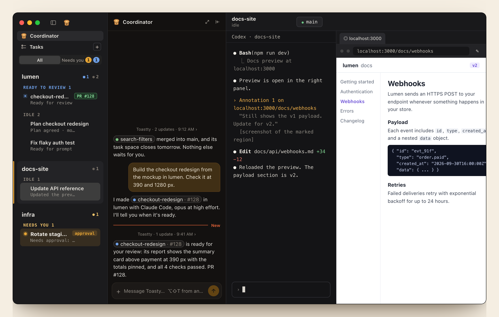
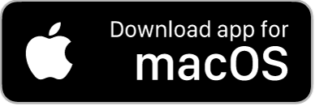
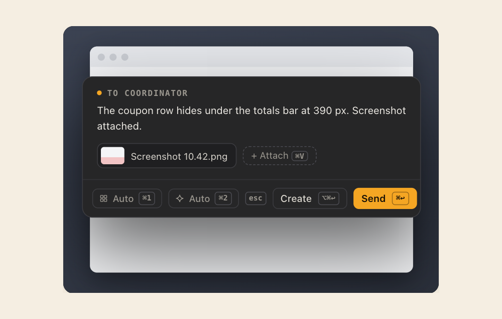
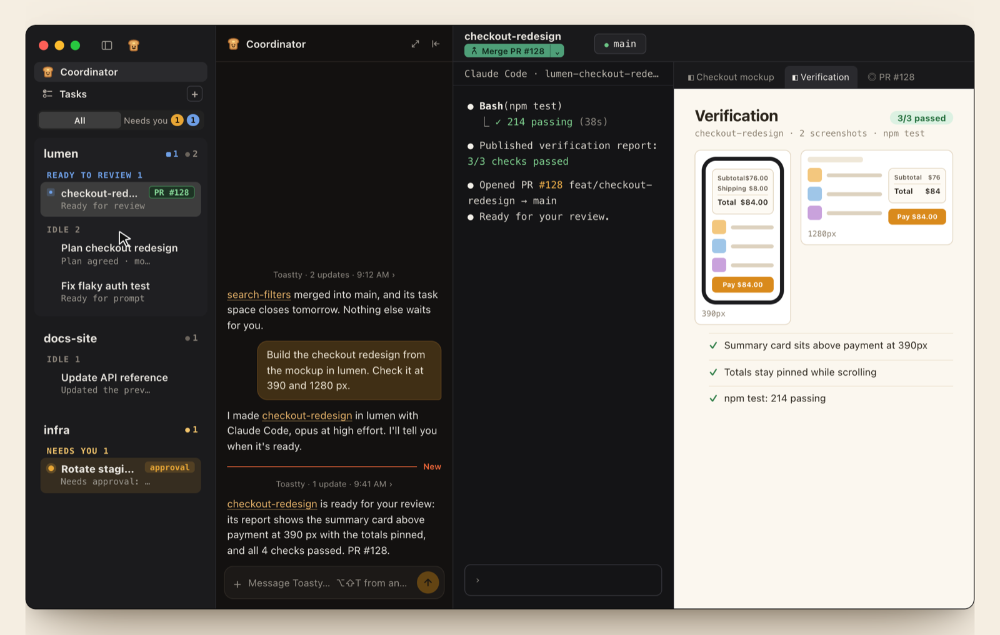
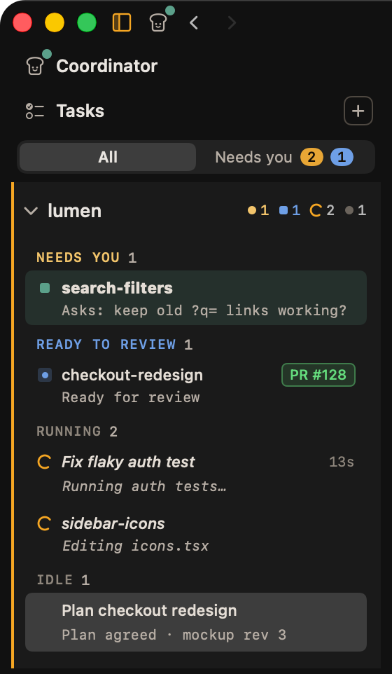
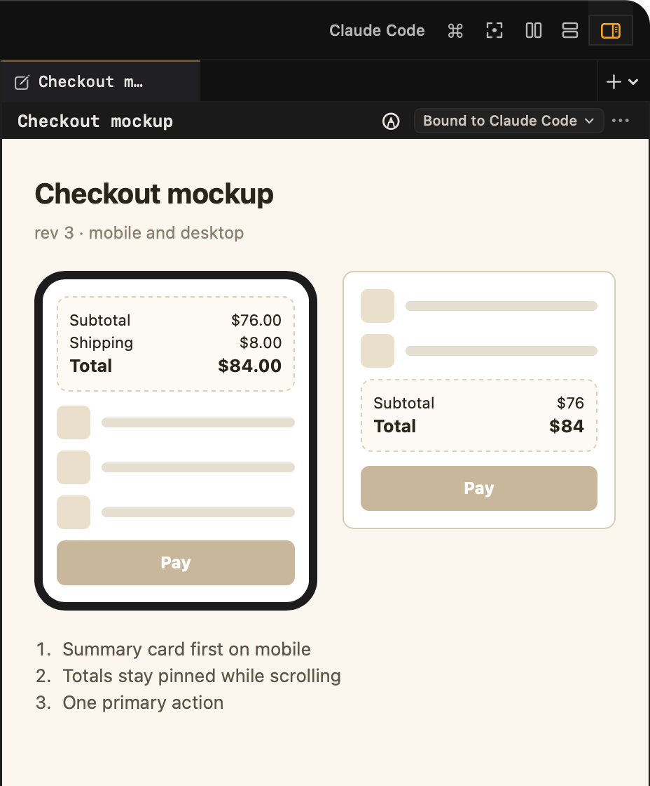
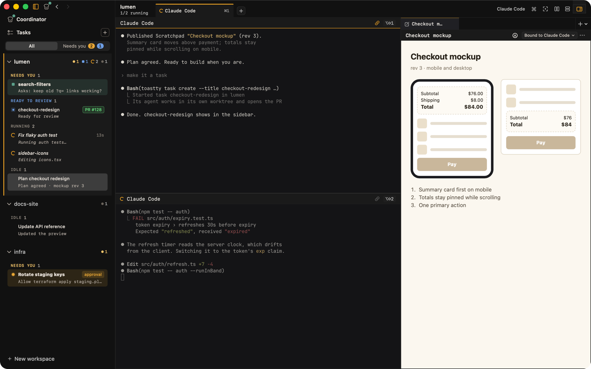
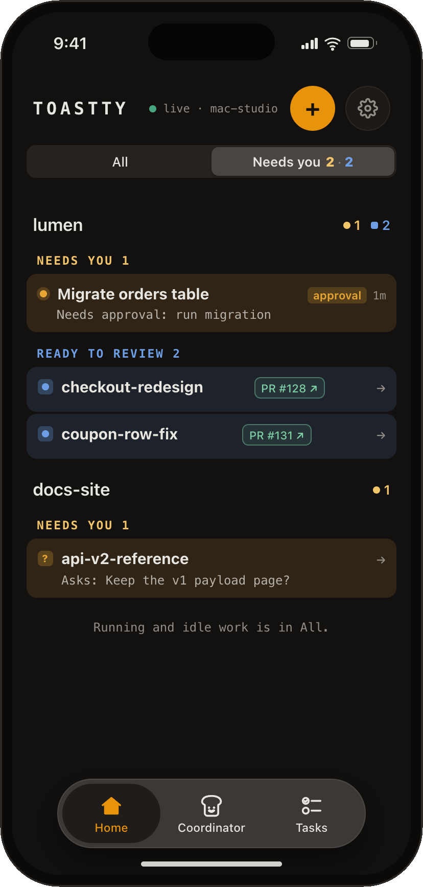

# Toastty

<p align="center">
  <a href="https://toastty.dev">
    
  </a>
</p>

<p align="center">
  <strong>Any agent. Any workflow.</strong><br>
  <a href="https://toastty.dev">Watch the tour on toastty.dev</a>
</p>

Toastty is a native macOS terminal multiplexer for coding agents, built on [Ghostty](https://ghostty.org). It gives your agents building blocks they can drive: workspaces, tabs, splits, a sidebar, and a side panel for docs, webpages, and an HTML scratchpad. Shape them into the workflow that fits how you work, with any agent that runs in a terminal.

<p align="center">
  <a href="https://github.com/figelwump/toastty/releases/latest">
    
  </a>
  <br>
  Requires macOS 14.0+
</p>

## Get started

1. **Download** the latest `.dmg` from [GitHub Releases](https://github.com/figelwump/toastty/releases/latest), open it, and drag Toastty to Applications. Your existing Ghostty config carries over.
2. **Paste the setup prompt** from **Toastty ▸ Get Started with Toastty…** into any agent running in a Toastty pane. It walks the agent through shell integration and status hooks, previewing every change before it writes anything:

   ```text
   You are helping me set up Toastty. Please run:

   "$TOASTTY_CLI_PATH" setup guide

   Read the guide, narrate each step, dry-run every setup installer first (pass --dry-run), show me the planned writes, and wait for my explicit OK before rerunning anything with --apply.
   ```

3. **Start a task.** Press `Option+Shift+T` from any app, describe the work, and pick the project and the agent. Toastty's shipped [task skills](docs/tasks.md) take it to a pull request and Merge; see [Your first task](docs/tasks.md#your-first-task). Describe anything else you do the same way each time, and let your agent write a skill for it in `~/.toastty/skills`.

Updating from 0.9.x? See [what changes](docs/tasks.md#updating-from-09x). To build from source, see [Building and Releasing](docs/building-and-releasing.md).

## What a workflow looks like

<table>
  <tr>
    <td width="33%"></td>
    <td width="33%"></td>
    <td width="33%"></td>
  </tr>
  <tr>
    <td>Press <code>Option+Shift+T</code> in any app and describe the task. Its agent starts in a task space of its own and moves into a git worktree when you say to implement.</td>
    <td>Keep working elsewhere. The task moves to Ready to review when its pull request is open.</td>
    <td>Read the agent's report and the PR, then press Merge. Toastty merges and cleans up the worktree.</td>
  </tr>
</table>

A workflow is a skill in `~/.toastty/skills` that tells your agent which of Toastty's pieces to use and when. Toastty delivers those skills to managed Codex, Claude Code, Cursor, Grok Build, OpenCode, MiMo Code, and Pi launches. The task lifecycle is built in: tell the task's agent to implement the work, and Toastty continues the conversation in a new worktree; press Merge on the task, and its agent checks the PR, Toastty merges it and cleans up the worktree. See [Tasks](docs/tasks.md). Other ideas to describe to your agent: start a workspace from a Linear or GitHub issue, open a task space per PR to review, or split a spec into tasks.

## Features

### Tasks and the coordinator

- **Quick entry:** `Option+Shift+T` opens a small panel over any app. Write the task, drop in screenshots or files, pick the project and the agent, and press `Cmd+Return`.
- **One task, one task space:** the agent shapes the work with you, then moves into its own git worktree, opens a pull request, and waits for your review. **Merge** checks the pull request and merges it; Toastty then removes the worktree.
- **The Tasks view** (`Cmd+Shift+T`) lists every task by stage, with its pull request, branch, agent, history, and actions.
- **The coordinator:** one long-lived agent session that follows your tasks. It tells you what needs you, unblocks stuck tasks, turns your requests into tasks, and brings a daily list of what waits for you. `Cmd+Shift+K` opens its chat in a dock beside your work.
- **Webhooks** send task events to a bot or service that you approve.

See [Tasks](docs/tasks.md), starting with [Your first task](docs/tasks.md#your-first-task).

### Sidebar and agents



- **Live status** for Claude Code, Codex, Cursor, Grok Build, OpenCode, MiMo Code, and Pi. Type `claude`, `codex`, `cursor-agent`, `grok`, `opencode`, `mimo`, or `pi` as usual, or launch from the `Agent` menu, top bar, or command palette. Any other CLI runs in a normal pane.
- **Automatic program status:** programs that report OSC 7501 get one sidebar row per terminal, with progress and specific approval, input, or login labels. Managed agent hooks remain primary.
- **Rows that need you are tinted:** green when ready, amber when waiting for approval, red on an error.
- **Grouped by state:** each project card lists its sessions and tasks under Needs you, Ready to review, Running and Idle. Switch to **Needs you** to see only what waits for you, from every project.
- **Task spaces** nest under their project, each with its own status and chips such as `PR #128`.
- Sessions that start their own subagents or background work show them as expandable rows.
- **Jump to what's next:** `Cmd+Shift+A` cycles through unread panels, sessions that need input, task spaces ready for review, and active sessions. `Cmd+Shift+L` marks a session for later; the flag clears when the session moves forward.
- **Watch any command:** `Cmd+Shift+M` gives a long build or test run its own row and a notification when it exits.
- **Unread badges and macOS notifications**, so you can look away.

See [Running Agents](docs/running-agents.md) for agent profiles, instrumentation, and custom agents.

<br clear="right">

### Right panel



- **Scratchpad:** agents publish HTML pages for plans, mockups, diagrams, and reports. A session can bind several Scratchpads and choose which receives commands that do not name a document.
- **Local files:** Markdown, code, configs, logs, and CSV open in an editable view with line numbers.
- **Browser:** previews, dashboards, and PRs beside the terminal.
- **Annotate and send:** mark up a page or Scratchpad and send numbered comments with screenshots to an agent.
- Each tab keeps its own right panel. `Cmd+Shift+B` shows or hides it.

See [Right Panel](docs/right-panel.md) for shortcuts, Recently Opened, and link handling.

<br clear="right">

### Workspaces, tabs, and splits

<p align="center">
  
</p>

- Named workspaces in the sidebar; switch with `Option+1`–`Option+9`. `Cmd+N` opens another window.
- Tabs per workspace (`Cmd+T`) and splits (`Cmd+D`, `Cmd+Shift+D`). `Cmd+Shift+F` zooms the focused panel.
- `Cmd+Shift+P` opens the command palette for actions, workspaces, agents, and files.
- Workspaces, tabs, and splits come back after a restart.

### Terminal

- GPU-accelerated Ghostty rendering; your existing Ghostty config just works.
- [Terminal profiles](docs/terminal-profiles.md): one-key launchers for tmux, zmx, SSH, or any startup command.
- With [shell integration](docs/shell-integration.md), restored panes keep their own command history, including inside tmux and zmx.
- `Cmd+F` finds text in the scrollback or the focused document.

### Toastty Mobile (TestFlight)



The same sidebar, on your iPhone, over your private tailnet.

- **Every session and task, live:** the same project cards and stages as on the Mac, a Tasks tab, and a Coordinator tab with its chat.
- **Create and merge tasks:** **+** opens New Task, or share a screenshot from another app. Merge, archive, and mark tasks done from the phone.
- **Answer your agents' questions:** pick an option or type a custom answer. It lands in the terminal on your Mac as if you were there.
- **Reply from anywhere** with photos and files attached. While the agent works, queue a follow-up for the next turn, steer a Codex or Claude Code turn, or stop it.
- **Scratchpads and files:** open the pages, documents, and previews your agents published, and tap a PR chip to read the pull request.
- **Private by design:** Toastty listens only on your Mac, and Tailscale Serve carries conversations over your own tailnet. No Toastty account is needed. Optional iPhone notifications in push-enabled builds send session titles and status, and for tasks the task's title, the agent's question, and the pull request number, through Cloudflare and Apple.

It is available through TestFlight for now. See it in motion at [toastty.dev/#mobile](https://toastty.dev/#mobile); [Remote Access](docs/remote-access.md) covers pairing and the tailnet setup.

<br clear="right">

## Automate it

Everything above can be driven from scripts and skills through the bundled `toastty` CLI and a local socket. Toastty injects `TOASTTY_CLI_PATH` into every pane it starts:

```bash
"$TOASTTY_CLI_PATH" action run workspace.create title=review activate=false
"$TOASTTY_CLI_PATH" action run panel.create.local-document --workspace "$WS" filePath="$PWD/PLAN.md" placement=rightPanel
"$TOASTTY_CLI_PATH" action run workspace.set-annotation --workspace "$WS" key=github-pr text="PR #128" url="$PR_URL"
```

Run `"$TOASTTY_CLI_PATH" action list` and `query list` to see what the running app supports. See the [CLI reference](docs/cli-reference.md) and the [socket protocol](docs/socket-protocol.md).

## Keyboard shortcuts

| Shortcut | Action | Shortcut | Action |
|---|---|---|---|
| `Cmd+Shift+A` | **Jump to the next session that needs you** | `Cmd+Shift+P` | Command palette |
| `Cmd+Shift+L` | Mark a session for later | `Cmd+D` | Split horizontally |
| `Cmd+Shift+B` | Show or hide the right panel | `Cmd+Shift+D` | Split vertically |
| `Cmd+Shift+F` | Zoom the focused panel | `Cmd+T` | New tab |
| `Cmd+Shift+M` | Watch the running command | `Option+1`–`9` | Switch workspace |
| `Option+Shift+T` | **New task, from any app** (quick entry) | `Cmd+Shift+T` | Show or hide the Tasks view |
| `Cmd+Shift+K` | Show the coordinator's chat dock | | |

See the [full shortcut reference](docs/keyboard-shortcuts.md).

## Configuration

- Ghostty settings come from your Ghostty config.
- Toastty settings: `~/.toastty/config` ([Configuration](docs/configuration.md))
- Agent launchers: `~/.toastty/agents.toml` ([Running Agents](docs/running-agents.md#agentstoml))
- Tasks, quick entry, and the coordinator: `~/.toastty/tasks.toml` ([Tasks](docs/tasks.md#toasttytaskstoml))
- Terminal profiles: `~/.toastty/terminal-profiles.toml` ([Terminal Profiles](docs/terminal-profiles.md))

Use `Toastty > Manage Config…` to edit settings inside Toastty and `Toastty > Reload Configuration` to apply them without relaunching.

## Privacy

Toastty is local-first and sends no usage analytics or telemetry. It checks for updates through Sparkle; other connections come only from features you use, such as Scratchpad web fonts, Remote Access, or a diagnostics report you approve. Logs are written to `~/Library/Logs/Toastty/toastty.log`. See [Privacy and Local Data](docs/privacy-and-local-data.md) for every file and connection Toastty uses and how to turn logging off.

## Documentation

- [Configuration](docs/configuration.md) — `~/.toastty/config`, `config-reference`, menu actions, and Toastty-owned config keys
- [Tasks](docs/tasks.md) — your first task, approval prompts, updating from 0.9.x, quick entry, worktrees, the coordinator, stages, merging, webhooks, and `tasks.toml`
- [Running Agents](docs/running-agents.md) — agents.toml configuration, profile IDs, instrumentation, skills, worktree tasks, and manual integration
- [Right Panel](docs/right-panel.md) — Scratchpad, browser, and local-document tabs, annotations, and shortcuts
- [Remote Access](docs/remote-access.md) — private tailnet setup, Toastty Mobile pairing, remote replies, and security guidance
- [Agent Hooks](docs/agent-hooks.md) — one global hook script for normalized session lifecycle and status events
- [Keyboard Shortcuts](docs/keyboard-shortcuts.md) — workspace, pane, tab, agent, and profile shortcuts
- [CLI Reference](docs/cli-reference.md) — `toastty` CLI commands, flags, environment variables, and integration examples
- [Building and Releasing](docs/building-and-releasing.md) — build the macOS and iOS apps from source, validate changes, and publish signed releases
- [Architecture Overview](docs/architecture/overview.md) — source layout and how state flows through the app
- [Ghostty Integration](docs/ghostty-integration.md) — XCFramework setup, config bridging, action parity
- [Environment and Launch Flags](docs/environment-and-build-flags.md) — build toggles, runtime env vars, automation args, and script-level inputs
- [Terminal Profiles](docs/terminal-profiles.md) — `terminal-profiles.toml` schema, shortcuts, and example profile setups
- [Shell Integration](docs/shell-integration.md) — manual shell setup for live pane titles and restored-pane command journals
- [Runtime Sandboxing](docs/runtime-sandboxing.md) — runtime-home strategies, `instance.json`, and cleanup guidance
- [Privacy and Local Data](docs/privacy-and-local-data.md) — local files, permissions, sockets, logging, and Ghostty crash-reporting notes
- [Socket Protocol](docs/socket-protocol.md) — v1.0 JSON-RPC automation protocol
- [State Invariants](docs/state-invariants.md) — AppState correctness rules and validation
